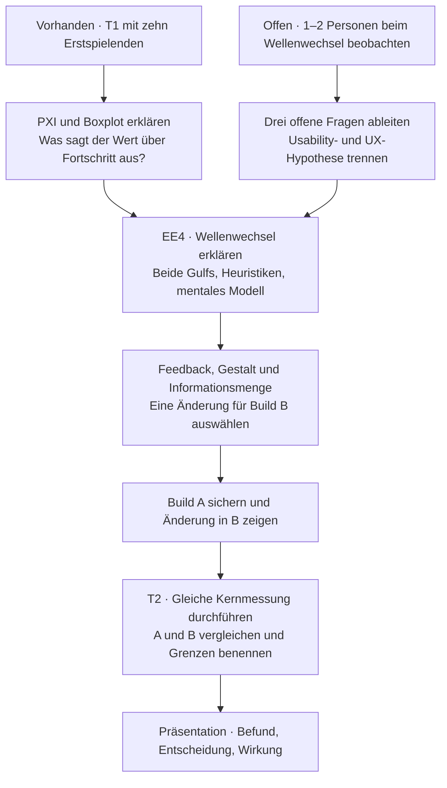

# Impfany · Lerngraph für Experience Engineering

**Stand 24. November 2026.** Eure erste Messung (T1) steht. Der kürzeste Weg zur Abschlusspräsentation führt von **einem gemessenen Problem über eine beobachtete Spielsituation zu einer überprüfbaren Änderung**. Dafür bietet sich der Übergang zwischen zwei Wellen an. Der PXI-Wert für *Progress Feedback* liegt bei −0,47 auf einer Skala von −3 bis +3. Im Code löst das Wellenende die Spiellogik aus, und ein Presenter aktualisiert beim Wellenstart den Text. Ob Erstspielende diesen Übergang im Kampf wahrnehmen, ist eine offene Forschungsfrage. _EE3-Ergebnisse (lokale Arbeitsmappe)_ · [GameFlow](../../ImpfanyGame/Assets/Features/GameFlow/Scripts/GameFlow.cs) · [Wellenanzeige](../../ImpfanyGame/Assets/Features/GameFlow/Scripts/UI/HUD/WaveTextPresenter.cs)

## Was habt ihr schon, was fehlt?

„Offen“ bedeutet hier, dass im Projektordner kein entsprechender Nachweis auffindbar war. Falls ihr Beobachtungsnotizen, Builds oder Abgaben bereits außerhalb des Repos habt, könnt ihr sie zuordnen und den Schritt überspringen. Seitenangaben beziehen sich auf die PDF-Seiten ab 1.

| Bereich | Was bei Impfany belegt ist | Was für Aufgabe oder Präsentation noch zu tun ist |
|---|---|---|
| **EE0 · HCI, Usability, UX** | Zielgruppe, Nutzungssituation und ein Maß für Bedienbarkeit stehen im Studiendesign. | Die Begriffe am Spiel erklären: Erkennt jemand, wann die nächste Welle beginnt? Wie fühlt sich der Übergang an? Den UCD-Zyklus daran zeigen: Nutzungskontext verstehen → Anforderungen ableiten → Lösung gestalten → mit Spielenden evaluieren. _EE0, S. 29–40_ |
| **EE1 · Beobachtung und Fragen** | EE2 enthält eine Forschungsfrage und ein Hypothesenpaar zur Bedienbarkeit. | Gefordert sind **1–2 beobachtete Personen, mindestens drei offene Fragen und je eine Hypothese zu Usability und UX**. H₀ und H₁ aus EE2 gehören zur selben Frage. Protokoll, positive/negative oder überraschende Momente und eine daraus hergeleitete UX-Hypothese sind offen. Einen nachgeholten Termin als solchen datieren. _EE1, S. 35_ |
| **EE2 · Erste Studie** | Einheitlicher Zehn-Minuten-Test für Erstspielende, Hypothese zu *Ease of Control*, PXI, Enjoyment, Demografie und beide Einwilligungsvorlagen liegen vor. EE3 belegt die Durchführung. Eine Bedingung ist für diesen ersten Test ausdrücklich vorgesehen. | Getesteten Build/Commit, Gerät, Startszene und tatsächlich verwendete Anleitung zuordnen. Zehn vollständige Fälle übertreffen die geplante Gesamtzahl acht. Ob **jedes** der vier Mitglieder mindestens zwei Personen getestet hat, geht aus der anonymen Tabelle nicht hervor. Teamseitig prüfen. Ausgefüllte Einwilligungen bleiben entsprechend eurem Studienplan getrennt von Antwortdaten und Repo. [Studiendesign](../../Vorlesungen/EE2_Studie-T1-planen/EE2-Studiendesign.docx) · [EE2, S. 42](<../../Vorlesungen/EE2_Studie-T1-planen/EE_WS26_02_Evaluating Experiences.pdf>) |
| **EE3 · Auswertung T1** | 10 von 12 Interviews vollständig. PXI-Kennwerte, separates Enjoyment, Demografie, Boxplots, Hypotheseneinordnung und Entwicklungsideen sind vorhanden. Die lokale Mappe unter `Vorlesungen/EE3_Auswertung-T1/lokal/` enthält zusätzlich Einzelscores und die verwendeten SoSci-Daten. | Die vorhandene Auswertung für die Präsentation nutzen. *Ease of Control* liegt mit M = 1,30 über 0, bei Median = 2,17 und SD = 2,02. Acht Personen bewerten die Steuerung positiv, zwei negativ. Das stützt die Erwartung **deskriptiv für diese Gruppe**. Der Challenge-Wert (−0,80) allein verrät weder „zu leicht“ noch „zu schwer“. _EE3-Ergebnisse (lokale Arbeitsmappe)_ · _EE3, S. 23_ |
| **EE4 · Interface analysieren und verbessern** | HUD und Wellenereignisse sind implementiert. EE3 schlägt vor, die Erkennbarkeit von Welle und Wellenabschluss zu prüfen. | Offen ist die begründete Überarbeitung: beide Norman-Gulfs untersuchen, alle acht Shneiderman-Regeln am Spiel prüfen, Bild und Ton analysieren, Gestaltgesetze anwenden, ein vergleichbares Spiel-HUD bzw. einen Styleguide heranziehen und mentales Modell mit dem Systemmodell abgleichen. Vorher/Nachher am laufenden Prototyp zeigen. _EE4, S. 3 und 37_ |
| **Weitere Kursziele · Optimierung und T2** | Der Kursüberblick nennt Feedback, Belohnung, Entscheidungen, Information Balancing und einen zweiten Test. Der aktuelle Bestand enthält detaillierte Vorlesungssätze bis EE4. | Feedback nach Zeitpunkt, Häufigkeit, Rhythmus und Motivation begründen. Im *Decision Walkthrough* eine Entscheidung im Spiel mit verfügbarer Information, Zeitdruck und möglichen Folgen durchgehen. Optimierten Build B testen und T1/T2 vergleichen. Die Aufgabennummern für spätere Arbeiten variieren zwischen Zeitplan und Analysefolie. Orientiert euch am geforderten Ergebnis. _EE0, S. 9–11 und 21–25_ · _EE3, S. 25_ |

## Der kürzeste Lernweg

Pfeile bedeuten „liefert die Grundlage für“. Links startet ihr mit vorhandenem Material, rechts ergänzt ihr die Beobachtung. Beide Wege treffen bei derselben Designentscheidung zusammen.

### So bearbeitet ihr den Graphen im Team

1. **Parallel starten.** Ein Zweierteam öffnet die EE3-Boxplots und erklärt sich gegenseitig Mittelwert, Median und Streuung am Beispiel *Ease of Control*. Das andere beobachtet 1–2 Erstspielende im Ausgangsbuild. Eine Person moderiert, eine protokolliert sichtbare Handlungen und wörtliche Aussagen. Erst nach der Spielsituation nachfragen. Drei mögliche Einstiege: „Woran hast du das Wellenende erkannt?“, „Was hast du als Nächstes erwartet?“ und „Wie hat sich der Übergang angefühlt?“ Die endgültigen EE1-Fragen aus euren tatsächlichen Beobachtungen ableiten.
2. **Eine Szene gemeinsam durchgehen.** Vom letzten Gegner bis zum Beginn der nächsten Welle einen Clip oder zwei Screenshots ansehen. *Gulf of Evaluation*: Woran erkenne ich, dass die vorige Welle geschafft ist? *Gulf of Execution*: Wenn ich mich auf die nächste Welle vorbereiten will, ist mir klar, was ich jetzt tun kann? Festhalten, was der Code tut, was das HUD davon zeigt und was die beobachtete Person erwartet hat. Die acht Regeln aus EE4 auf S. 9 anhand dieser Szene und bei Bedarf an Start, Kampf oder Neustart prüfen. Pro Regel genügt für eure Arbeitsnotiz ein konkretes Beispiel oder eine begründete Einschränkung.
3. **Eine Änderung auswählen und messbar machen.** Falls der Abschluss übersehen wird, wäre ein kurzes „Welle geschafft“ am Ort der Wellenanzeige ein Kandidat. Nähe ordnet die Meldung der Wellenzahl zu, Figur–Grund-Kontrast hält sie vor der Arena lesbar. Prüft mit einem Referenz-HUD, ob Position und Dauer passen und ob ein Tonsignal zusätzliche Information liefert. Im Walkthrough festhalten: Was muss ich mitten im Kampf wissen? Was kann bis zum Wellenende warten? Den Hinweis nur übernehmen, wenn eure Beobachtung die Idee trägt.
4. **Build B gegen die Ausgangsmessung prüfen.** Vorab festhalten, welche Änderung B enthält und welche Messgröße dazu passt. Beispiel für UX: „Der mittlere PXI-Wert für Progress Feedback liegt in B höher als in A.“ Für Usability eignet sich „Erstspielende erkennen den Wellenabschluss ohne Nachfrage“. Für Letzteres braucht ihr eine vergleichbar erhobene Beobachtung in beiden Builds. Das alte T1 enthält dazu nur Fragebogenwerte. Für den PXI-Vergleich Aufgabe, Dauer, Instruktion, Items und Kodierung beibehalten. Neue Erstspielende vermeiden Übung aus A, dafür können sich die Gruppen in ihrer Spielerfahrung unterscheiden. Pro Build Stichprobe, Verteilung und Abweichungen berichten.
5. **Mit einer Folie pro Entscheidung proben.** Zeigt T1-Boxplot → beobachtete Szene → begründete Änderung A/B → T2-Ergebnis. Jedes Mitglied sollte erklären können, weshalb die Änderung sinnvoll erschien, wie ihr ihre Wirkung geprüft habt und welche andere Erklärung für einen Unterschied offenbleibt.

## Quizwissen mit wenig Doppelarbeit festigen

| Wann? | Gegenseitige Kurzprüfung am Projekt |
|---|---|
| Beim Vorbereiten der Beobachtung | Warum eignet sich Beobachtung für einen übersehenen Hinweis, der PXI für das erlebte Fortschrittsfeedback und eine Nutzungsmetrik für den Zeitpunkt des Übergangs? Je einen Vor- und Nachteil nennen. SUS (Bedienbarkeit), NASA-TLX (Beanspruchung), UEQ, GEQ und Wizard of Oz einordnen. Erklären, warum ihr standardisierte Items unverändert lasst. |
| Beim Formulieren der Hypothese | Spaß, Flow, Immersion und Präsenz am Arenakampf unterscheiden. Die EE2-Folie führt zusätzlich *Involvement* auf. Für Flow prüfen: klares Ziel und Fortschritt, unmittelbares Feedback, passende Herausforderung im Verhältnis zum Können. H₀/H₁, Stichprobe und Grundgesamtheit, Within-/Between-Design sowie Korrelation und Kausalität erklären. |
| Beim Lesen des Boxplots | Altersgruppe (ordinal) von Alter in Jahren (Verhältnisskala) unterscheiden. Den Weg von den drei Itemantworten zum Score einer Person und weiter zum Gruppenmittel erklären. Am Boxplot Median, Quartile, IQR und Whisker zeigen. Erklären, welche Frage stattdessen ein Histogramm beantwortet. |
| Beim Zeigen des HUD | Zühlkes Verarbeitungskette an einem sichtbaren oder hörbaren Signal erklären: Reiz wahrnehmen → Muster erkennen → Bedeutung verstehen → Handlung ausführen. An derselben Stelle die beiden Gulfs, eine Shneiderman-Regel, ein Gestaltgesetz und die Erwartung der spielenden Person zeigen. |

Nutzt die Originalfragen für einen zweiten Durchlauf ohne Unterlagen. _Quiz EE0–EE3_ · _Quiz EE4, S. 36_

## Was am Ende abgegeben wird

Laut Kursfolie ist die **Abgabe am Mittwoch, 2. Dezember 2026** (aktualisiert), die **Präsentation am Donnerstag, 3. Dezember 2026** (20–25 Minuten Vortrag, danach Fragen). Für das Abgabepaket nennt die Folie:

- Präsentationsfolien aller Aufgaben als PDF, Nutzerdaten als XLSX und den **tatsächlich eingesetzten** SoSci-Fragebogen als XML. Die vorhandene Datei heißt „PXI“ und enthält das Kurs-Fragenpaket. Den Export eures eingesetzten Formulars mit Demografie und Ablauf prüfen. Dabei auch die Antwortcodes bestätigen: Die Auswertung dokumentiert 1 = Ablehnung und 7 = Zustimmung. [PXI-Paket](../../Vorlesungen/EE2_Studie-T1-planen/Kursmaterial/package_PXI_2026-11-17_komplett.xml)
- Versuchsaufbau, Ablauf, Einwilligungsunterlagen und Arbeitsverteilung als PDF sowie Spielprototyp A vor und B nach der Verbesserung. Die unterscheidbaren Versionen mit dem tatsächlich getesteten Stand verknüpfen. [Vorhandene Arbeitsverteilung](<../Abgabe/Team-roles-and-responsibilities.md>)
- Individuelle Reflexion (je 0,5–1,5 Seiten) und KI-Erklärung. Im Abgabeordner liegen bereits vier KI-Texte und die Rollenverteilung. Für EE die Beiträge, Stunden und Reflexion mit dem tatsächlichen Stand abgleichen. Dateien mit dem Präfix `EE26_group#_` und eurer Gruppennummer über Sciebo abgeben. _Bewertung und Abgabe, EE0 S. 21–26_
