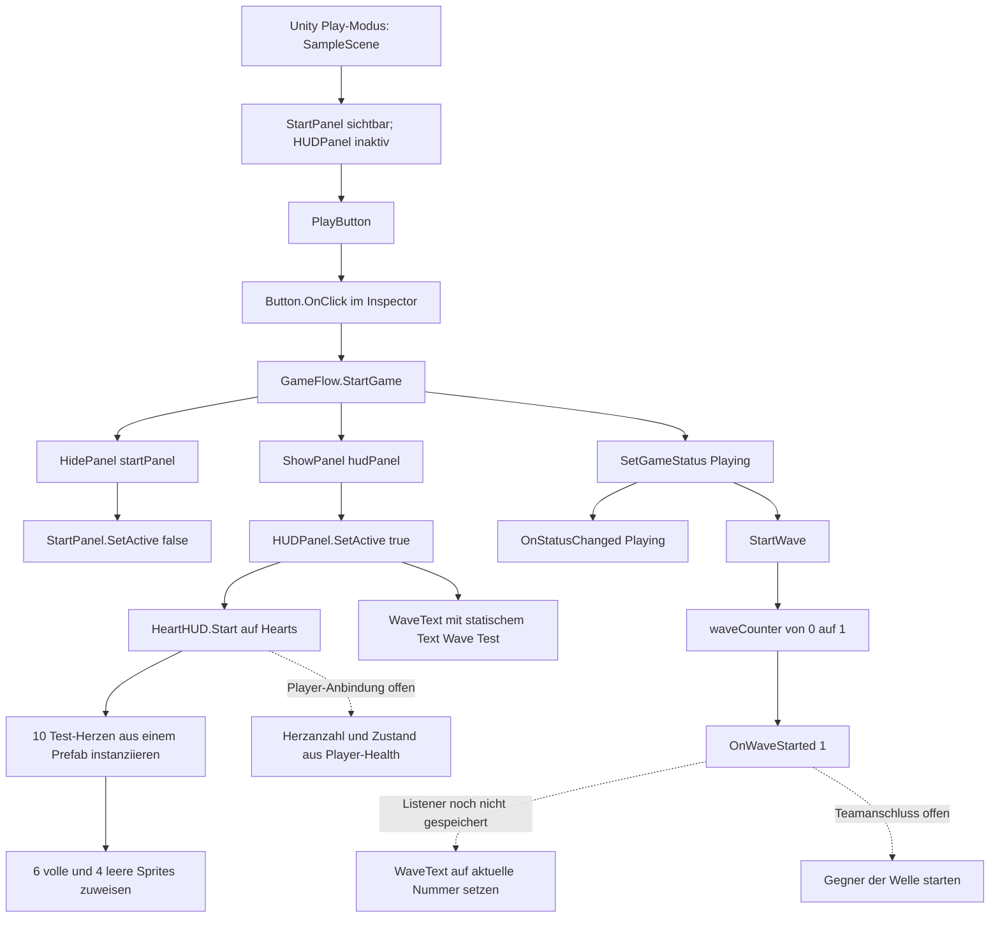

# Merlin – Flow, UI & Audio (Entwurf zur Durchsicht)

## Meine Zuständigkeit

Ich arbeite am Startmenü, Spielablauf aus Sicht der UI, HUD und später Pause, Game Over, Neustart und Audio.

## Aktueller Aufbau

- **Szenen:** Ich habe meine UI aus `ImpfanyGame/Assets/Scenes/testScene/MerlinScene.unity` auch in `ImpfanyGame/Assets/Scenes/SampleScene.unity` übernommen. In der `SampleScene` liegt `GameUI` mit `StartPanel`, `HUDPanel` und einem `EventSystem`. Der `PlayButton` ist im Inspector mit `GameFlow.StartGame()` verbunden. Die Szenenänderung liegt im Commit `8f0996c`; das ist noch kein abgeschlossener Test des gesamten Team-Spiels.
- **Start und Status:** Beim Klick blendet `StartGame()` das `StartPanel` aus und das `HUDPanel` ein. Danach setzt die Methode den Status auf `Playing` und ruft `StartWave()` auf. Mein `GameStatus`-Enum enthält `StartMenu`, `Playing`, `Shop`, `Paused` und `GameOver`; bisher wird nur der Wechsel zu `Playing` ausgelöst. `OnStatusChanged` meldet diesen Wechsel. Die Status-/Event-Änderungen liegen im Commit `cd75c49`.
- **Wellenzähler:** `GameFlow` beginnt bei `waveCounter = 0`. `StartWave()` erhöht ihn nur im Status `Playing` und sendet `OnWaveStarted` mit der neuen Nummer. Der Play-Button löst damit im aktuellen Code den Start der **gezählten Welle 1** aus. Dieses Event startet noch keinen Gegner-Spawn und ist nicht mit Maxims Wellensystem verbunden.
- **Herzen:** `HUDPanel/Hearts` trägt eine `HorizontalLayoutGroup` und `HeartHUD`. Das Script erzeugt in `Start()` aus **einem** zugewiesenen `HeartImage`-Prefab Herz-Instanzen; die ersten erhalten das volle, die übrigen das leere Sprite. In der gespeicherten `SampleScene` stehen derzeit `testHeartCount = 10` und `testFilledHearts = 6` im Inspector. Das sind **Testwerte**, keine Daten aus Hugos Player-Health. Die früheren drei sichtbaren Herzen waren ein Test in meiner eigenen Szene; in der `SampleScene` habe ich im Play-Modus zehn `HeartImage(Clone)` in der Hierarchy gesehen.
- **Wellentext:** `HUDPanel/WaveText` ist in der gespeicherten `SampleScene` noch ein `TextMeshProUGUI` mit dem statischen Text `Wave (Test)` und der LiberationSans-SDF-Schrift. Ein `WaveTextPresenter` beziehungsweise ein Listener für `OnWaveStarted` ist dort bisher **nicht** gespeichert. Das Event und die sichtbare Wellenanzeige sind also noch nicht miteinander verbunden.
- **Anzeigeprüfung:** In meinem Play-Test in der `SampleScene` wechselten die Panels beim Klick. Herzen und Wellentext erschienen zunächst nicht im sichtbaren Ausschnitt der Game-View; in der Hierarchy waren die Herz-Klone vorhanden und in der Scene-View der Wellentext zu sehen. Die Game-View stand bei `1920×1080` auf `Scale 1×`, sodass nur ein Ausschnitt sichtbar war. Ob beide Elemente nach Anpassung des Vorschau-Zooms im gesamten Game-Bild wie gewünscht aussehen, ist noch nicht bestätigt. Die zuletzt gespeicherten Positionen sind `Hearts (425, -184)` und `WaveText (511, -287)` bei Top-Left-Ankern. Diese Werte sind Szenenstand, keine Empfehlung für das fertige Layout.

## Aktueller Button- und Anzeigeweg

**Lesart:** Durchgezogene Pfeile zeigen gespeicherten Code und Inspector-Verbindungen; den Panelwechsel und die Klone habe ich im Play-Modus beobachtet. Die Event-Aufrufe folgen aus dem Code, aber einen Event-Empfänger oder echten Spawn habe ich nicht getestet. Gestrichelte Pfeile sind noch offen. Die Anzeige von `WaveText` im ganzen Game-Bild muss ich noch einmal prüfen.

## Offene Anschlüsse und nächste Schritte

1. Die gesamte Game-View statt nur des `1×`-Ausschnitts ansehen und prüfen, ob die zehn Testherzen und `Wave (Test)` sichtbar und richtig positioniert sind. Das HUD-Layout nicht nur auf einen beschnittenen Editor-Ausschnitt ausrichten.
2. `WaveText` an `OnWaveStarted(int)` anbinden und im Play-Modus prüfen, ob nach dem Klick `Wave 1` erscheint. Mit Maxim absprechen, wie sein tatsächlicher Spawn auf den Start reagiert und wann die nächste Welle beginnt; ein Event allein erzeugt keine Gegner.
3. Mit Hugo aktuelle/maximale Gesundheit, Änderungen und gegebenenfalls halbe Herzen abstimmen; erst danach die Herz-Testwerte ersetzen. `Shop`, `Paused`, `GameOver`, Neustart und Audio anschließend mit den jeweiligen Team-Systemen verbinden und im gemeinsamen Ablauf testen.

## Technische Fundstellen

- `ImpfanyGame/Assets/Scripts/GameFlow/GameFlow.cs` – Panelwechsel, Status, Wellenzähler und Events.
- `ImpfanyGame/Assets/Scripts/GameFlow/GameStatus.cs` – benannte Spielphasen.
- `ImpfanyGame/Assets/Scripts/UI/HUD/HeartHUD.cs` – Herzinstanzen und vorläufige Sprite-Auswahl.
- `ImpfanyGame/Assets/Scenes/SampleScene.unity` – aktueller Menü-/HUD-Aufbau, `EventSystem`, Button-Verbindung und Inspector-Testwerte.
- `ImpfanyGame/Assets/Scenes/testScene/MerlinScene.unity` – meine ursprüngliche Testszene.
- `ImpfanyGame/Assets/Prefabs/UI/HeartImage.prefab` – verwendetes Herz-Image-Prefab.

*KI-Unterstützung: Hermes hat den gespeicherten Code, die Szenen und meine Screenshots geprüft und mir beim Formulieren dieses Textes und des Mermaid-Diagramms geholfen. Die Umsetzung und die beschriebenen Play-Tests stammen von mir. Den fertigen HUD-Anzeigetest und die Anbindung an Player-Health und Gegnerwellen habe ich noch nicht bestätigt.*
