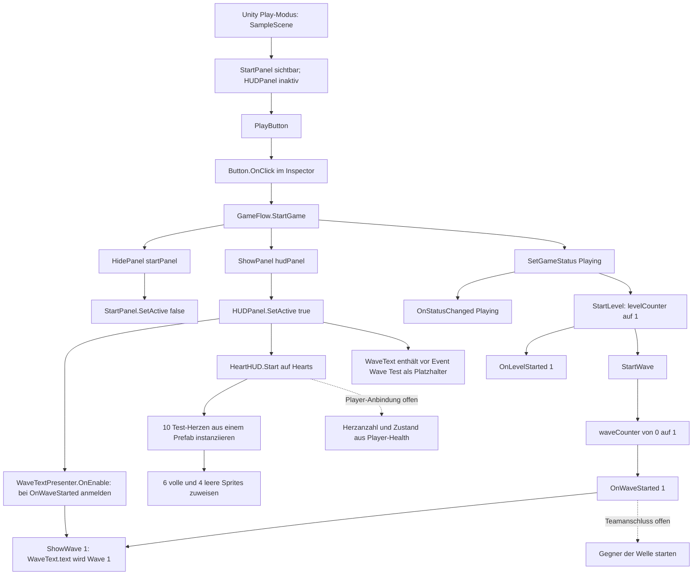

# Merlin – Flow, UI & Audio (Entwurf zur Durchsicht)

## Meine Zuständigkeit

Ich arbeite am Startmenü, Spielablauf aus Sicht der UI, HUD und später Pause, Game Over, Neustart und Audio.

## Aktueller Aufbau

- **Szenen:** Ich habe meine UI aus `ImpfanyGame/Assets/Features/GameFlow/Scenes/MerlinScene.unity` auch in `ImpfanyGame/Assets/Scenes/SampleScene.unity` übernommen. In der `SampleScene` liegt `GameUI` mit `StartPanel`, `HUDPanel` und einem `EventSystem`. Der `PlayButton` ist im Inspector mit `GameFlow.StartGame()` verbunden. Die Szenenänderung liegt im Commit `8f0996c`; das ist noch kein abgeschlossener Test des gesamten Team-Spiels.
- **Start und Status:** Beim Klick blendet `StartGame()` das `StartPanel` aus und das `HUDPanel` ein. Danach setzt die Methode den Status auf `Playing`, ruft `StartLevel()` und anschließend `StartWave()` auf. Mein `GameStatus`-Enum enthält `StartMenu`, `Playing`, `Shop`, `Paused` und `GameOver`; bisher wird nur der Wechsel zu `Playing` ausgelöst. `OnStatusChanged` meldet diesen Wechsel. Level- und Wave-Start sind verschiedene Ereignisse; Shop, Pause und Game Over sind noch keine fertigen Übergänge.
- **Level und Wellen:** `GameFlow` beginnt bei `levelCounter = 0` und `waveCounter = 0`. Nach Play erhöhen `StartLevel()` und `StartWave()` im Status `Playing` ihre Zähler und senden `OnLevelStarted(1)` beziehungsweise `OnWaveStarted(1)`. Ein Level soll mehrere Waves enthalten; nach dem abgeschlossenen Level führt der Shop zum nächsten Level. Diese vollständigen Übergänge sind noch nicht implementiert. `OnLevelStarted` meldet den Start, nicht den Abschluss eines Levels. Das Wellen-Event startet noch keinen Gegner-Spawn und ist nicht mit Maxims Wellensystem verbunden.
- **Herzen:** `HUDPanel/Hearts` trägt eine `HorizontalLayoutGroup` und `HeartHUD`. Das Script erzeugt in `Start()` aus **einem** zugewiesenen `HeartImage`-Prefab Herz-Instanzen; die ersten erhalten das volle, die übrigen das leere Sprite. In der gespeicherten `SampleScene` stehen derzeit `testHeartCount = 10` und `testFilledHearts = 6` im Inspector. Das sind **Testwerte**, keine Daten aus Hugos Player-Health. Die früheren drei sichtbaren Herzen waren ein Test in meiner eigenen Szene; in der `SampleScene` habe ich im Play-Modus zehn `HeartImage(Clone)` in der Hierarchy gesehen.
- **Wellentext:** In der gespeicherten `SampleScene` liegt jetzt ein eigenes, aktives `WaveTextPresenter`-Objekt unter dem zunächst inaktiven `HUDPanel`, neben `WaveText`. Mein Script `WaveTextPresenter.cs` meldet `ShowWave(int)` in `OnEnable()` bei `GameFlow.OnWaveStarted` an und in `OnDisable()` wieder ab. Beide Inspector-Referenzen (`gameFlow`, `waveText`) sind in der Szene gesetzt. `StartGame()` aktiviert zuerst das HUD und löst erst danach `StartWave()` aus: Der Presenter kann sich daher vor dem Event anmelden. `ShowWave` setzt den englischen Text auf `Wave {number}`. Im gespeicherten TMP-Feld steht vor dem Start noch `Wave (Test)`; **ich habe im Play-Modus geprüft und sehe nach dem Start `Wave 1`**. Das ist mein berichteter Test der lokalen Anzeige, kein von Hermes ausgeführter Play-Test. Der Zähler ist weiterhin nur mein `GameFlow`-Wert, nicht Maxims Gegner-Wellensystem.
- **Anzeigeprüfung:** In meinem früheren Play-Test in der `SampleScene` wechselten die Panels beim Klick. Herzen und Wellentext erschienen zunächst nicht im sichtbaren Ausschnitt der Game-View; in der Hierarchy waren die Herz-Klone vorhanden und in der Scene-View der Wellentext zu sehen. Die Game-View stand bei `1920×1080` auf `Scale 1×`, sodass nur ein Ausschnitt sichtbar war. Inzwischen sehe ich `Wave 1` im Play-Modus; ob auch die zehn Testherzen im vollständigen Game-Bild richtig angeordnet sind, ist noch nicht bestätigt. Im aktuellen gespeicherten Szenenstand haben beide Top-Left-Anker; die Positionen lauten `Hearts (20, -20)` und `WaveText (110, -70)`. Das sind Szenenwerte, keine Empfehlung für das fertige Layout.

## Aktueller Button- und Anzeigeweg

**Lesart:** Durchgezogene Pfeile zeigen gespeicherten Code und Inspector-Verbindungen; die Anzeige `Wave 1` habe ich zusätzlich im Play-Modus bestätigt. Den Panelwechsel und die Herz-Klone habe ich früher im Play-Modus beobachtet. Gestrichelte Pfeile sind offene Team-Anschlüsse.

## Offene Anschlüsse und nächste Schritte

1. Die zehn Testherzen im vollständigen Game-Bild auf Sichtbarkeit und Position prüfen; den Wellentext `Wave 1` habe ich bereits im Play-Modus gesehen.
2. Mit Maxim absprechen, wie sein tatsächlicher Spawn auf den Start reagiert und wann die nächste Welle beginnt; mein Event allein erzeugt keine Gegner.
3. Mit Hugo aktuelle/maximale Gesundheit, Änderungen und gegebenenfalls halbe Herzen abstimmen; erst danach die Herz-Testwerte ersetzen. `Shop`, `Paused`, `GameOver`, Neustart und Audio anschließend mit den jeweiligen Team-Systemen verbinden und im gemeinsamen Ablauf testen.

## Technische Fundstellen

- `ImpfanyGame/Assets/Features/GameFlow/Scripts/GameFlow.cs` – Panelwechsel, Status, Wellenzähler und Events.
- `ImpfanyGame/Assets/Features/GameFlow/Scripts/GameStatus.cs` – benannte Spielphasen.
- `ImpfanyGame/Assets/Features/GameFlow/Scripts/UI/HUD/HeartHUD.cs` – Herzinstanzen und vorläufige Sprite-Auswahl.
- `ImpfanyGame/Assets/Features/GameFlow/Scripts/UI/HUD/WaveTextPresenter.cs` – Anmeldung bei `OnWaveStarted` und Anzeige der Wave-Nummer.
- `ImpfanyGame/Assets/Scenes/SampleScene.unity` – aktueller Menü-/HUD-Aufbau, `EventSystem`, Button-Verbindung und Inspector-Testwerte.
- `ImpfanyGame/Assets/Features/GameFlow/Scenes/MerlinScene.unity` – meine ursprüngliche Testszene; der Presenter ist dort noch nicht angebunden.
- `ImpfanyGame/Assets/Features/GameFlow/Prefabs/HeartImage.prefab` – verwendetes Herz-Image-Prefab.

*KI-Unterstützung: Hermes hat den gespeicherten Code, die Szenen und meine früheren Screenshots geprüft und mir beim Formulieren dieses Textes und des Mermaid-Diagramms geholfen. Die Umsetzung und die beschriebenen Play-Tests – einschließlich der sichtbaren Anzeige `Wave 1` – stammen von mir. Die Anbindung an Player-Health und Gegnerwellen ist noch nicht bestätigt.*
