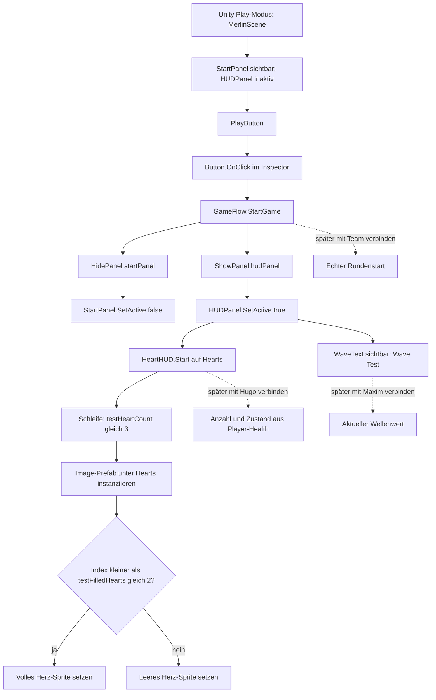

# Merlin – Flow, UI & Audio (Entwurf zur Durchsicht)

## Meine Zuständigkeit

Ich arbeite am Startmenü, Spielablauf aus Sicht der UI, HUD und später Pause, Game Over, Neustart und Audio.

## Aktueller Aufbau

- **Testszene:** `ImpfanyGame/Assets/Scenes/testScene/MerlinScene.unity`.
- **Menü und HUD:** Unter `GameUI` gibt es `StartPanel` mit Titel und `PlayButton` sowie das anfangs inaktive `HUDPanel`. Der Button ist im Inspector mit `GameFlow.StartGame()` verbunden.
- **Wechsel:** `GameFlow.StartGame()` ruft `HidePanel(startPanel)` und `ShowPanel(hudPanel)` auf; diese Methoden setzen die Panels per `SetActive(false)` beziehungsweise `SetActive(true)`. Es wird dadurch bislang nur die Anzeige umgeschaltet.
- **Herzen:** `HUDPanel/Hearts` trägt eine `HorizontalLayoutGroup` und `HeartHUD`. Das Script erzeugt in `Start()` aus **einem** zugewiesenen Image-Prefab Herz-Instanzen als Kinder des Containers. Im aktuellen Inspector stehen `testHeartCount = 3` und `testFilledHearts = 2`; volle und leere Sprites sind zugewiesen. Der Code wählt für die ersten beiden Bilder das volle und für das dritte das leere Sprite. Das sind **Testwerte**, keine Player-Health-Daten.
- **Welle:** `HUDPanel/WaveText` enthält derzeit den statischen Text `Wave (Test)`.

## Aktueller Button- und Anzeigeweg

**Lesart:** Durchgezogene Pfeile beschreiben den gespeicherten UI-/Codepfad. Gestrichelte Pfeile sind **noch nicht implementierte Integrationen**, keine bereits funktionierenden Aufrufe. `WaveText` ist ein sichtbarer Bestandteil des aktivierten HUD und keine Funktion, die `GameFlow` aufruft.
## Offene Anschlüsse und nächste Schritte

1. Mit Hugo abstimmen, wie aktuelle/maximale Gesundheit und deren Änderungen bereitgestellt werden, einschließlich der Umrechnung auf ganze beziehungsweise halbe Herzen. Danach die Testwerte ersetzen.
2. Mit Maxim abstimmen, wie der aktuelle Wellenwert und ein Wellenwechsel an die UI gelangen. Danach `Wave (Test)` ersetzen.
3. Start, Game Over, Neustart, Pause und Audio mit den jeweiligen Team-Systemen verbinden und in der gemeinsamen Spielszene testen.
## Technische Fundstellen

- `ImpfanyGame/Assets/Scripts/GameFlow/GameFlow.cs` – Start-Button-Aktion und Panelwechsel.
- `ImpfanyGame/Assets/Scripts/UI/HUD/HeartHUD.cs` – Herzinstanzen und vorläufige Sprite-Auswahl.
- `ImpfanyGame/Assets/Scenes/testScene/MerlinScene.unity` – Button-Verdrahtung, Panels, Inspector-Werte und `WaveText`.
- `ImpfanyGame/Assets/Prefabs/UI/FullHeartImage.prefab` – aktuell zugewiesenes Herz-Image-Prefab.

*KI-Unterstützung: Hermes hat den gespeicherten Code und die Szene geprüft und mir beim Formulieren des Textes und des Mermaid-Diagramms geholfen. Die Umsetzung und die beschriebenen Play-Tests stammen von mir. Ob die neue Sprite-Auswahl im Play-Modus wie erwartet aussieht, habe ich noch nicht bestätigt.*
