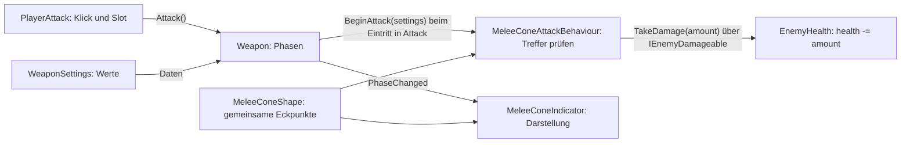
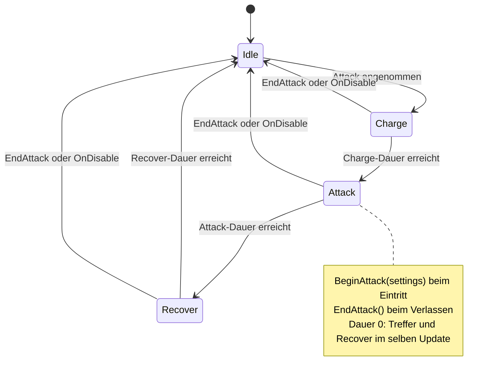
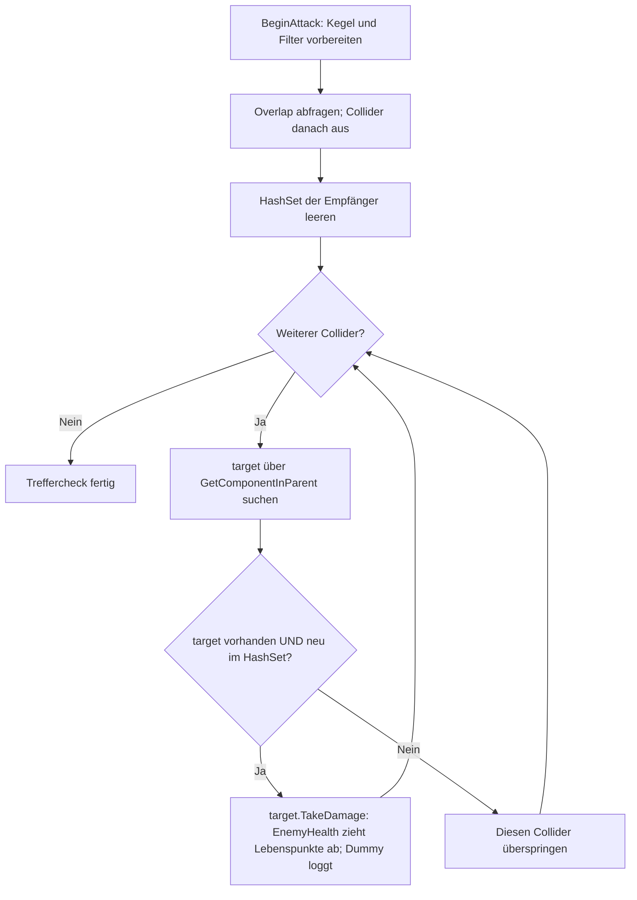
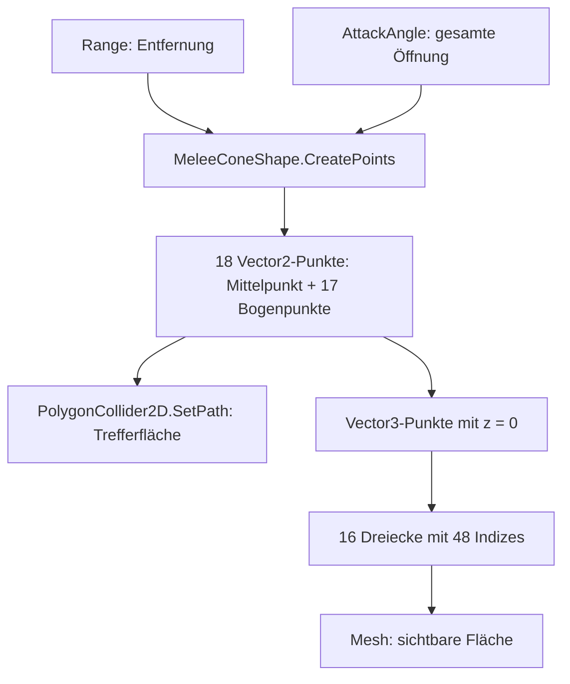
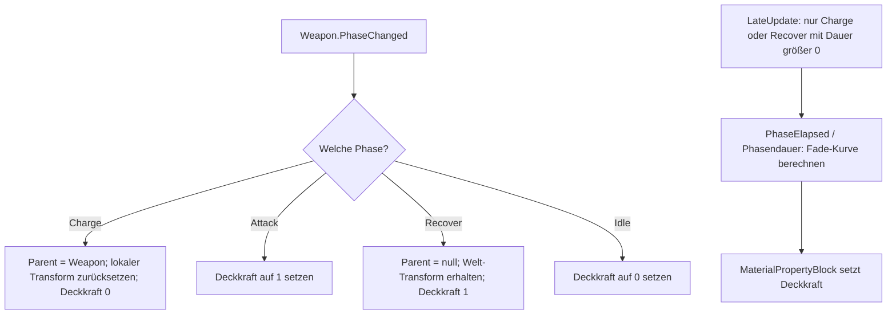
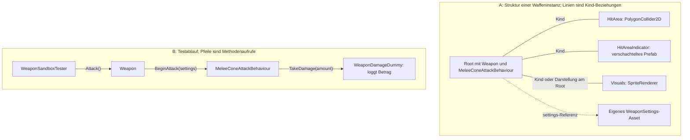

# Waffensystem – Systemdiagramme

Stand: 13.11.2026 · Codebasis: `cf29e0b`. [Offline-Ansicht](WeaponSystems.html) · [Dokumentationsübersicht](../README.md).

Die Diagramme beschreiben den gespeicherten Code. Bewegungseffekte, Ergebnis-Events und die spezielle Dash-API sind noch geplant. Weitergehende Spielregeln stehen in den verlinkten Systemdokumenten.

**Leserichtung:** Aufrufpfeile führen vom Aufrufer zur ausgeführten Methode. Datenpfeile sind entsprechend beschriftet. In Bild 6 bedeuten einfache Linien Parent/Kind-Beziehungen; der gestrichelte Pfeil ist eine Asset-Referenz. Vererbung ist kein Ausführungsschritt.

## 01 · Aufrufweg – Vom Klick zum Lebenspunkte-Abzug

Oben steht der tatsächliche Aufrufweg. Darunter stehen die unterstützenden Daten und die Darstellung.

**Im Code:** [Weapon.cs](../../../ImpfanyGame/Assets/Features/Progression/Scripts/Weapon/Weapon.cs), [WeaponSettings.cs](../../../ImpfanyGame/Assets/Features/Progression/Scripts/Weapon/WeaponSettings.cs), [WeaponAttackBehaviour.cs](../../../ImpfanyGame/Assets/Features/Progression/Scripts/Weapon/WeaponAttackBehaviour.cs), [MeleeConeAttackBehaviour.cs](../../../ImpfanyGame/Assets/Features/Progression/Scripts/Weapon/AttackBehaviours/MeeleCone/MeleeConeAttackBehaviour.cs)

## 02 · Zustände – Ein Aufruf, ein kompletter Ablauf

Weapon verwaltet genau eine aktuelle Phase und eine Uhr für diese Phase.

**Im Code:** [Weapon.cs](../../../ImpfanyGame/Assets/Features/Progression/Scripts/Weapon/Weapon.cs), [WeaponPhase.cs](../../../ImpfanyGame/Assets/Features/Progression/Scripts/Weapon/WeaponPhase.cs)

## 03 · Schaden – Ein Gegner bekommt nur einen Treffer

Die Physik findet Collider. Pro Collider wird ein Empfänger gesucht, geprüft und höchstens einmal aufgerufen.

**Im Code:** [MeleeConeAttackBehaviour.cs](../../../ImpfanyGame/Assets/Features/Progression/Scripts/Weapon/AttackBehaviours/MeeleCone/MeleeConeAttackBehaviour.cs), [IEnemyDamageable.cs](../../../ImpfanyGame/Assets/Features/Progression/Scripts/Interfaces/IEnemyDamageable.cs), [WeaponDamageDummy.cs](../../../ImpfanyGame/Assets/Features/Progression/Scripts/Test/WeaponDamageDummy.cs)

## 04 · Geometrie – Eine Form, zwei Verwendungen

MeleeConeShape berechnet gemeinsame Eckpunkte für Trefferfläche und sichtbaren Kegel.

**Im Code:** [MeleeConeShape.cs](../../../ImpfanyGame/Assets/Features/Progression/Scripts/Weapon/AttackBehaviours/MeeleCone/MeleeConeShape.cs), [MeleeConeIndicator.cs](../../../ImpfanyGame/Assets/Features/Progression/Scripts/Weapon/AttackBehaviours/MeeleCone/MeleeConeIndicator.cs)

## 05 · Darstellung – Zielen, treffen, Trefferort zeigen

Der Indikator folgt beim Aufladen und bleibt während Recover am alten Trefferort.

**Im Code:** [MeleeConeIndicator.cs](../../../ImpfanyGame/Assets/Features/Progression/Scripts/Weapon/AttackBehaviours/MeeleCone/MeleeConeIndicator.cs)

## 06 · Unity & Zusammenarbeit – Zusammenbauen und unabhängig testen

Zwei getrennte Ansichten: oben die Struktur, unten der Aufrufweg eines Sandbox-Tests.

**Im Code:** [WeaponSandboxTester.cs](../../../ImpfanyGame/Assets/Features/Progression/Scripts/Test/WeaponSandboxTester.cs), [WeaponDebugAttackBehaviour.cs](../../../ImpfanyGame/Assets/Features/Progression/Scripts/Test/WeaponDebugAttackBehaviour.cs), [WeaponDamageDummy.cs](../../../ImpfanyGame/Assets/Features/Progression/Scripts/Test/WeaponDamageDummy.cs)

## Pflege

Diagramme und Beschriftungen in `build_diagrams.py` ändern, dann vom Repository-Root `python3 Docs/WeaponSystem/Diagrams/build_diagrams.py` ausführen. Markdown und HTML gemeinsam aktuell halten; gegen den Code und im Browser prüfen. Die Generierung ändert keine Unity-Dateien.
